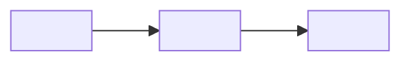

# Skill: Change walkthrough (read a diff, follow it, diagram it)

Use when the user wants to *understand* a set of changes: "explain this diff", "what did this
commit do", "walk me through the branch", "diagram the flow of this change". The goal is that the user
can read and own the change, not a bug review (that is a separate code-review step).

## Output language

Write the walkthrough in the user's language. Code identifiers, file paths and the Mermaid node
labels that name code stay in their original form.

## Steps

1. **Resolve the range — do not ask if it is obvious.**
   - User gave a commit, range or branch → use it (`git show <sha>`, `git diff <a>..<b>`).
   - Otherwise, uncommitted changes exist (`git status --porcelain`) → the
     working tree (`git diff` + `git diff --staged`, plus untracked files from `git status`).
   - Otherwise → the current branch against its base (`git merge-base HEAD <base>`; the base is
     the one the project docs name, else development/main/master, whichever exists).
   State the range you used in one line.
2. **Read the changes.** `git diff --stat` first for the shape, then the full diff. For each
   changed file, read enough of the *surrounding* code (callers, the store/service it feeds, the
   template that renders it) to explain how the change connects. Never describe a connection you have not read.
3. **Find the flow.** Identify the entry point (route, user action, API call, lifecycle hook,
   CLI command) and follow the data/event through the changed code to where it ends (UI,
   request, state, output).
4. **Write the walkthrough** in the format below. Keep it short: it is a reading guide, not a
   copy of the diff.

## Output format

~~~markdown
## Walkthrough — <range>

**What changed and why:** <3–5 lines: the intent, the behavior before vs after>

**Reading order:**
1. `<path>` — <one line: what changed here and its role>
2. ...
(model/types → helpers → store/service → component → template/styles → tests)

**Flow:**


**Look at carefully:**
- <behavior changes, edge cases, null/empty/error paths, anything not covered by tests>
~~~

## Diagram rules

- **Mermaid only**, small: 5–10 nodes. `flowchart LR` for a data/event flow, `sequenceDiagram`
  only when the order of calls between 3+ parties is the point (e.g. component → store → API).
- Nodes are real units from the code (function, store method, component, endpoint). Mark the ones
  this change adds or modifies with a trailing `*` in the label (e.g. `submit()*`).
- Quote labels that contain parentheses, brackets or other punctuation (`B["submit()*"]`) —
  unquoted `()` inside `[...]` breaks the Mermaid parser.
- Write only the ```` ```mermaid ```` block. Do **not** build a viewer link or encode the
  diagram yourself — an encoded URL written by a model is invented bytes. (REI adds an
  "open diagram" link under each block on its own.)
- If the change has no meaningful flow (renames, styles, copy, config), **skip the diagram** and
  say so in one line — do not draw a diagram for the sake of it.

## Hard rules

- **Read-only.** Do not edit files, stage, commit or run anything that changes state.
- **Ground every claim.** Every file, function or connection mentioned must come from the diff or
  from code you actually read.
- **Large diffs** (more than ~15 files or ~800 changed lines): say so, give "What changed and why" and
  the reading order for the whole range, and offer to walk through it in parts (by commit or by
  folder) instead of guessing at the details.
